= Making Content for {OR}

About ORTS:: Open Rails Train Simulator is an open-source simulator created after Microsoft Train Simulator 2.0 was cancelled. {OR} is designed to remain compatible with most existing {MSTS} content while adding new features and fixing many old Microsoft/Kuju limitations. MSTS and ORTS terms are often used interchangeably, but {OR} can handle more complex models, higher polygon counts, longer viewing distances, 32-bit color, and many simulator features that {MSTS} does not support.

(((Open Rails, "The Open Rails Train Simulator, free and open source project" )))

OPEN RAILS::
Compared with Microsoft Train Simulator, Open Rails can usually keep good frame rates with more polygons. This allows smoother curves and more modeled detail. Open Rails also supports 32-bit color, while Microsoft Train Simulator is limited to 16-bit color. View distance can also be adjusted from about 2 km to 10 km.

_from Open Rails.org website_

This notebook focuses on using Blender. Other 3D modeling tools are mentioned only when they provide useful contrast.

<<<

== Common Terms and Definitions
(((Making Contentm TERMS. DEFINITIONS)))

3D modeling and simulator content creation use specialized terms. The following definitions cover the terms used most often in this notebook.

ALPHA:: A bitmap channel that makes part of an image transparent or partially transparent.
DISTANCE LEVELS:: See Level of Detail (LOD).
EDGE:: A line connecting two vertices.
ENG FILE:: A simulator configuration file for an engine or locomotive. It defines physical details such as motive power, braking, couplers, and other properties.
FACE:: A surface made from three or more vertices.
FOOBIE:: A deliberately low-detail model that uses texture detail to create many visual variants from one base shape. The term is a contraction of "fake boobies."
HARD SURFACE MODELING:: Modeling rigid objects such as vehicles, buildings, weapons, roads, and machinery. It usually uses standard mesh objects such as cubes, cylinders, planes, cones, and torus shapes.
HDRI:: High Dynamic Range Image. In Blender, HDRI environment maps are often used to light a scene with realistic real-world lighting information.
HIERARCHY:: The parent-child relationship between objects in a shape. Child objects can move on their own, but they are still affected by the parent object.
LEVEL OF DETAIL:: (LOD) A system that swaps the main model for simpler versions at greater distances. Distant models need fewer details because the viewer cannot see them clearly. There are no fixed LOD ranges, but you should use them when they help performance.
MANIFOLD SHAPE:: A watertight 3D object. Its vertices, edges, and faces connect so that no water would leak out if the object were filled. A default cube is manifold.
MATERIAL:: A surface definition assigned to a model. It may include a texture, lighting behavior, palette information, and shading settings.
MESH:: A 3D model shape made from faces, before textures are applied.
NGON:: A face with five or more vertices. Many Blender tools work best with quads or ngons and may not work as well after a mesh has been triangulated.
NORMAL:: A vector perpendicular to a face. Normals control which way a face points and affect how textures and lighting are displayed. footnote:[See https://en.wikipedia.org/wiki/Normal_(geometry)]
OBJECT:: A 2D object has length and height but no depth, such as a plane, polygon, or line. A 3D object has length, height, and depth, such as a cube or sphere.
ORGANIC MODELING:: Sculpted modeling for subjects such as people, animals, plants, trees, and some vehicles. Blender includes sculpting tools and NURBS-related tools, but those workflows are outside the scope of this notebook.
ORIGIN:: See Pivot Point.
PIVOT POINT:: The position used to align, rotate, and place a shape. It is also called the object's origin.
POLY COUNT:: The total number of polygons used in a mesh. It is a common way to describe model complexity.
POLYGON:: A flat face of a mesh. Edges define the polygon boundary, and vertices are the points where the edges meet. Blender commonly refers to triangle faces as tris and four-vertex faces as quads.
QUAD:: A face made from four vertices.
SHAPE:: A finished 3D object that is ready to be placed in the simulator environment.
SMOOTHING:: A shading setting that controls how individual polygons are lit by the simulator.
TRI:: A face made from three vertices. Also called a triangle.
UV:: The mapping system that projects a 2D texture image onto a 3D model. U and V are the texture axes, while X, Y, and Z are already used for 3D space.
VERTEX:: A point in 3D space with X, Y, and Z coordinates. Vertices are the points where edges and faces meet. The plural is vertices.
WAG FILE:: A simulator configuration file for a wagon or non-powered vehicle. It defines physical details such as braking, couplers, and other properties.

You should also describe the intended compatibility of your finished content in its README file.
(((Content Design, "Choices")))

Made for {MSTS}:: The content can run in Open Rails, but it may need WAG or ENG edits because some legacy {MSTS} physics values may not perform well in {OR}.
Made for ORTS - No other files required:: The content is configured for {OR} and requires no additional files.
Made for ORTS - but requires other add-ons:: The content is configured for {OR}, but needs other downloaded files to work. NAVS-based items are a common example.
Made for ORTS but Compatible with {MSTS}:: The content is built for {OR} but also configured to remain compatible with {MSTS}. This usually takes more work.
Made for ORTS but requires {MSTS}:: The content runs in {OR}, remains compatible with {MSTS}, and also requires files from a local {MSTS} installation.
Made for ORTS but requires {MSTS} and other add-ons:: The content is configured for {OR}, but also requires a local {MSTS} installation and other default or add-on files.

Choose the option that best matches your goals. Consider these questions:

* How familiar are you with Open Rails and its content options?
* How much effort do you want to put into this project?
* How much 3D modeling experience do you already have in tools such as Train Sim Modeler, GMAX, or 3D Canvas?
* How much Blender experience do you have?
* How much experience do you have creating content for Open Rails compared with {MSTS}?
* How flexible does your content need to be?

.Author's Advice
----
Start with the option that is easiest to understand, then adjust as you learn. If you are new to the workflow, a simple "Made for Open Rails" project is a good starting point.
----

[TIP]
Share your work. Talk with other content developers, ask for feedback, and learn what others are doing. This helps you avoid repeated mistakes and also makes it less likely that projects will be abandoned half-finished.

== Content Generation

Creating Open Rails content usually requires several related pieces. The list below is not complete, but it gives the basic shape of a simple train-related model project.

(((Blender, "Getting Started")))

* A mesh, which is the 3D model.
* Reference material and online resources. TrainSim.com and Elvas Tower are useful starting points: https://www.trainsim.com/vbts/forum.php and http://www.elvastower.com/forums/index.php
* A texture, also called a skin: a 2D bitmap image applied to the model.
* A UV map: the mapping that tells Blender how the 2D texture fits onto the 3D mesh. Blender can create UV maps, although tools such as UVLayout or Substance Painter can also be used.
* Configuration files that describe the content to the simulator. For rolling stock, these are usually WAG or ENG files.
* A thumbnail JPG. This is optional, but useful.
* Instructions. Do not leave the project half documented.

=== Programs you should have

* A 3D program. {version} is recommended. The current release, {BV}, should also be fine unless Blender's Python API has changed enough to affect the exporter add-on. Blender 5.0 is an example where exporter updates may be required.
* An exporter add-on for the {MSTS}/ORTS format. This notebook uses Wayne Campbell's _S File Exporter_ from Elvas Tower. footnote:[Download from https://github.com/pwillard/Blender_{MSTS}_ORTS_Exporter]
* A paint program with layers and channels.
* A text editor that handles Unicode files.

NOTE: If you also make models for Trainz Simulator, current Trainz versions can use files exported by Blender's built-in FBX exporter.

=== What the author uses

* 3D modeler: {bv}
* Bitmap tools: Canva, Affinity Studio, or Paint.NET
* UV/shader tools: Blender's built-in tools. Third-party tools such as Substance Painter exist, but I do not use them for this workflow.
* Text editor: _Microsoft Visual Studio Code_
* Metric conversion calculator: a hand-held calculator or Google
* Scale calculator: useful for converting dimensions from scale drawings. One is available at http://www.railsimstuff.com
* Texture snipping tool: Windows Snipping Tool or SHOEBOX, an Adobe Air application for game creation

[NOTE]
Use metric measurements when possible. Metric is the default in Blender and {OR}. U.S. customary units may be familiar, but metric is better for worldwide compatibility and is usually simpler once you stay with it.

==== Why the Author Uses Blender

(((Blender, "Why Blender?")))

From Pete Willard:: I started using 3D software for game content in 2002, mostly for {MSTS}. I have used Abacus Train Sim Modeler, 3D Canvas, Gmax, and SketchUp. 3D Canvas was my favorite for many years, but I now mainly use it only for file conversion. Blender has become my preferred tool because {BV} includes the features I need, has active support, and includes many tools that 3D Canvas lacks.

== Why Many Other People Use Blender to Make Content

Blender is a powerful, flexible, free, and open-source 3D application. It is widely used for game and simulator assets for several reasons.

Open-Source and Free:: Blender is free to use and has an active community of developers and users. It is accessible to hobbyists, indie developers, and professionals.
Versatility:: Blender includes tools for modeling, sculpting, texturing, rigging, animation, rendering, and more. It can create characters, environments, props, vehicles, and effects.
Integrated Workflow:: Modeling, editing, UV mapping, animation, and rendering can all happen in one application. This reduces the need to move between separate tools.
Asset Optimization:: Blender includes tools for LODs, texture baking, and UV map management, all of which help prepare assets for real-time rendering.
Community and Resources:: Blender has a large user community with many tutorials, forums, and training resources.
Non-Destructive Workflow:: Modifiers and procedural workflows allow changes without immediately destroying the original model data.
Constant Development:: Blender is updated often. New features and improvements arrive regularly, sometimes faster than users can keep up with.

Blender is not the only possible tool, but it is a strong choice if you want a free, capable, and actively developed modeling package.

To export a model for {MSTS} or {OR}, use Wayne Campbell's Blender MSTS/Open Rails exporter add-on for {MSTS}-format `.s` files.

=== What I Can Recommend

* 3D modeler: Blender {LTSversion} or the current stable {BV} release. Blender 3.6 LTS can still help with older workflows, but Blender 2.79-era workflows are no longer covered here. Blender is free.
* Bitmap tools: _Affinity Photo_, _Paint.NET_ (free), _GIMP_, _Krita_, or _PaintShop Pro_ if you already have it.
* UV tool: Blender's built-in UV and shader tools are enough for this notebook. Third-party tools are optional.
* Text editor: _Microsoft Visual Studio Code_, _Context.exe_, or _Sublime_.

.Author's Note:
****
Much of this document was created with Blender 3.6 LTS and updated while using Blender {BV}.
****

[NOTE]
CONTEXT is abandoned, but it had useful syntax highlighting for ENG and WAG files. Visual Studio Code is safer for current work. An ENG/WAG syntax-highlighting project is available at https://github.com/pwillard/engwag

(((Context, "An old but useful text editor")))

=== How to Install Blender

(((Blender, "Installation")))

[NOTE]
Blender.org releases new versions regularly. This notebook assumes a 64-bit Windows installation. The safest choice is the current LTS release. The latest stable release is also suitable when the exporter add-on supports it. This document is currently being checked against Blender {BV}.

(((Blender, "Installation")))

[TIP]
Blender can run in portable mode from a USB stick, but the MSI installer is usually the best choice.

[WARNING]
Current Blender versions do not install on Windows 7. Upgrade Windows before relying on this notebook. Some concepts still apply to old Blender versions, but the current workflow assumes a supported Blender release.
(((Windows 7, No longer supported)))

[WARNING]
If you install Blender from Steam, Steam may auto-update Blender by default. This can be inconvenient if you need to keep a specific Blender version for exporter compatibility.
(((Blender, "Installed via Steam")))

[NOTE]
Blender's user interface changes between versions. Screens in this notebook may not exactly match your installed version.

Download Blender from https://Blender.org/download/

The LTS release is linked from the "Looking for Long-Term Support? Get {version}" section. It is also available here: https://www.Blender.org/download/lts
(((Blender, "Long Term release, LTS")))

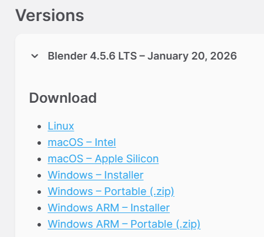

Hopefully, Blender.org will continue offering LTS releases.

Choose the Windows `Installer` option, download the `.MSI` file, and double-click it to install Blender.

.Blender Defaults
****
Blender normally uses your `Documents` folder for models and `%APPDATA%` for configuration data and add-ons under the `Blender Foundation` folder. Each Blender version has its own folder, so you can install multiple Blender versions on the same PC.

File associations can be tricky. The Blender version that opens when you double-click a `.blend` file is usually the most recently installed version. You may need to adjust this if you use multiple versions.
****

[TIP]
The APPDATA folder is normally hidden in Windows File Explorer. You can open it from a command prompt with `cd %appdata%`, or change File Explorer settings under menu:View[Options > View > Show hidden files, folders and drives].

In PowerShell, `%APPDATA%` can be shown like this:

[.listing]
----
PS C:\Users\willard> $env:APPDATA
C:\Users\willard\AppData\Roaming
----

Blender user data, including preferences, startup files, and third-party add-ons, is stored under `Blender Foundation` inside that folder. For example:

`C:\Users\willard\AppData\Roaming\Blender Foundation\Blender\4.5\config`

The following older video gives a general idea of installing and initially configuring Blender. The same steps are also described below.
(((Blender, "Installation Video")))
Video Link: https://youtu.be/ad4vTwCGodo

<<<

=== Setting up our Blender Environment

(((Blender, "Setup")))

Most of this setup is optional, but it helps create a comfortable starting environment. Exact settings may vary by Blender version.

On Blender's first-run splash screen, change kbd:[SPACEBAR] so it opens `Search` instead of playing the animation.

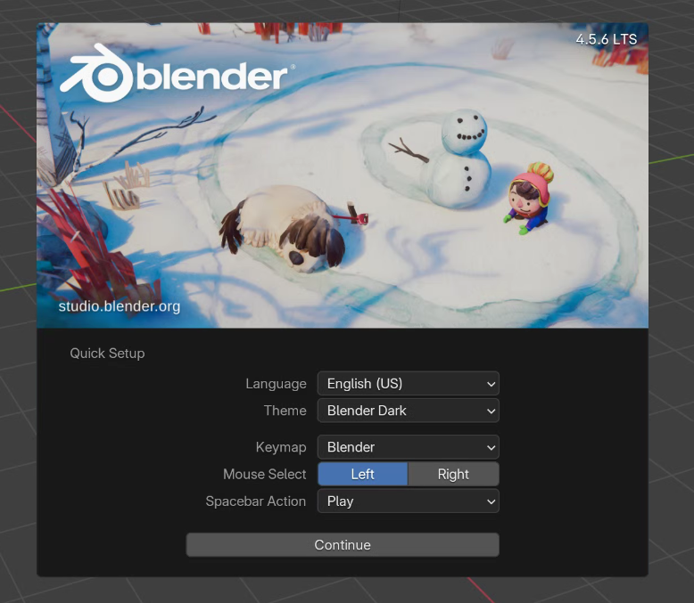

[NOTE]
You see the first-run screen only when the user preferences file does not exist. You can see it again after a fresh install or after deleting the user preferences file, such as: +
`%appdata%\Blender Foundation\Blender\3.3\config\userpref.blend`

Open preferences from menu:Edit[Preferences]. The gear icon on the top bar also leads there.

<<<

==== Interface

(((Blender, "Interface Preferences")))

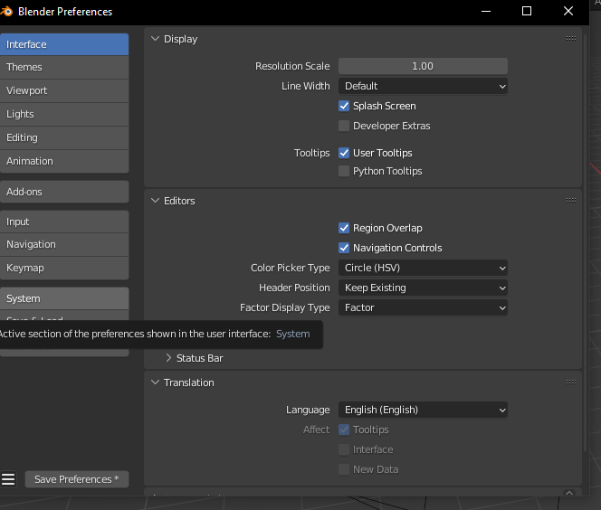

Use `Resolution Scale` to make Blender's interface text comfortable for your monitor. Move the slider left or right until the screen is readable.

Consider disabling the `Splash Screen` option after you are familiar with Blender.

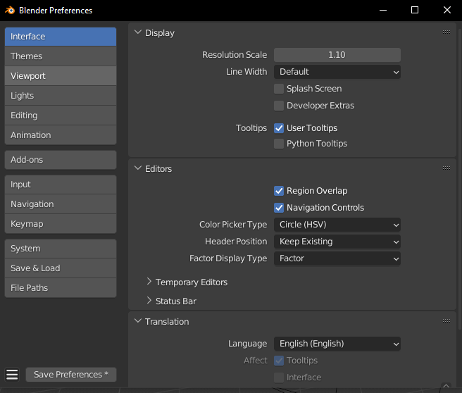

This screen shows the author's preferred settings.

<<<

==== Themes-3D Viewport

(((Blender, "Viewport Preferences")))

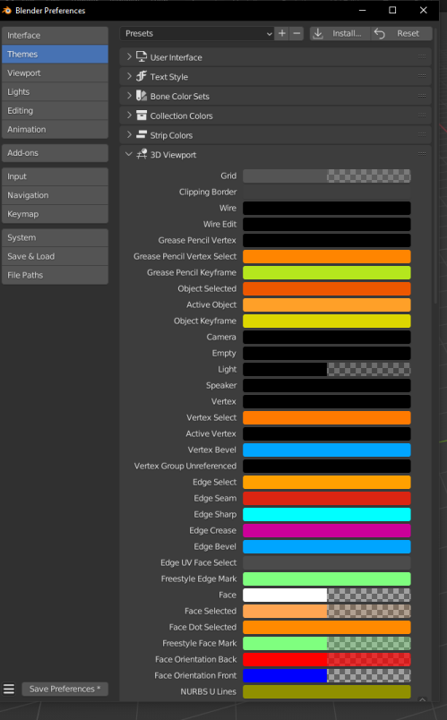

In menu:Themes[3D Viewport], adjust the Face Orientation Alpha setting. The default outside-face blue can be distracting when Face Orientation is enabled. Setting the blue alpha value to 0 hides the blue while still showing red for inside-facing normals.

At the bottom of this menu, increase the vertex size from 3 to 5 or 7 if vertices are hard to see in Edit Mode.

==== Viewport

For better viewport quality, adjust these settings.

In menu:Viewport[Quality]:

* Samples = 16

In menu:Viewport[Textures]:

* Anisotropic = 4x

You can also change the 3D Viewport Axis to a smaller Simple Axis if you do not like the large navigation gizmo.

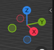

<<<

==== System

(((Blender, "System Preferences")))

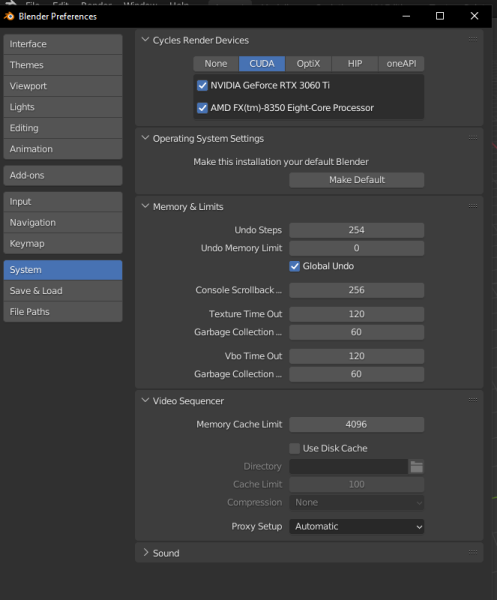

In menu:System[Cycles Render Tab]:

* Enable both CPU and GPU rendering with CUDA if your system supports it.

In menu:System[Memory & Limits]:

* Increase Undo Steps to 200 or higher. The maximum may be 254. The default of 32 is often too low.

[TIP]
Unless you are using modifiers for non-destructive modeling, most Blender edits are one-way after they are made. You can undo with kbd:[Ctrl+Z] only during the current editing session. Save versioned files such as `crane_V1.blend`, `crane_V2.blend`, and so on at the start of each session. This gives you a way back if later edits fail. Blender also has automatic backup options.

[TIP]
If you use Blender 4.3 or newer, open System settings under Network and enable `Allow Online Access`.

<<<

==== Save & Load

(((Blender, "Save & Load Preferences")))

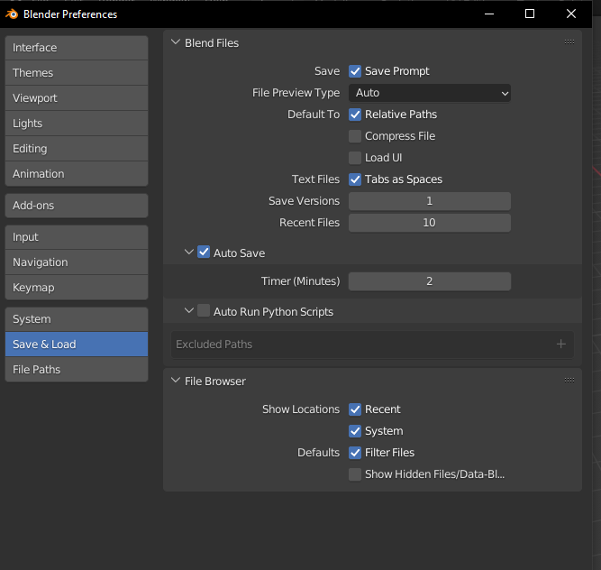

In menu:Save & Load[Blend Files], consider disabling `Load UI` when needed. If `Load UI` is enabled, Blender loads the interface layout saved inside the `.blend` file instead of using your normal interface. This can be confusing when opening someone else's file. You may want to turn it on or off depending on the project.

[TIP]
Re-enable `Load UI` when a `.blend` file intentionally stores special settings, such as millimeter units for 3D printing models.

[TIP]
Set `Save Versions` so Blender creates backup copies of the current `.blend` file.

==== File Paths

(((Blender, "File Paths")))

Because {OR} is a Windows program, this notebook uses modern Windows file paths. You can browse to these locations in Windows Explorer.

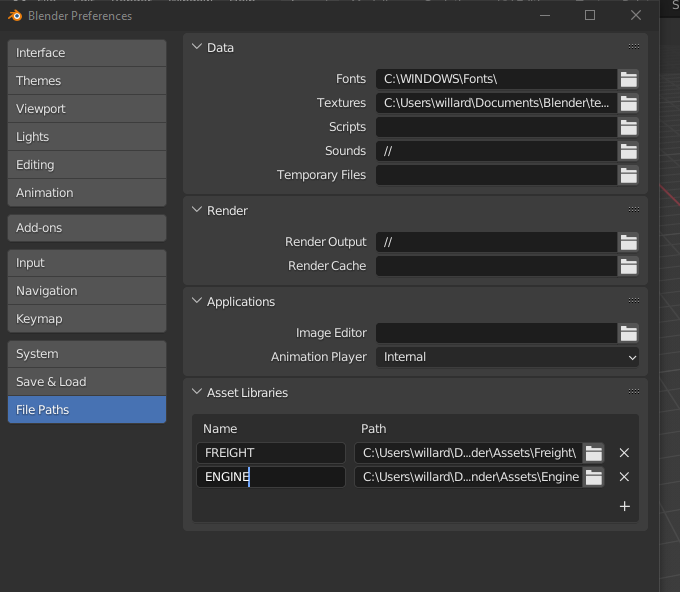

Blender has default or user-defined locations for fonts, textures, temporary files, scripts, and other resources. Many default to your Windows `Documents` folder.

In menu:File Paths[Data]:

* I usually set a shared texture library location for objects used across several models, such as `%USERPROFILE%/Documents/Blender/TEXTURES`.
* The Scripts location is where Blender Python scripts can be placed. One script needed later in this notebook may use this location.

=== Version Compatibility Notice

The following section applies to Blender 3.0 and later. Some Blender 4.0 and 5.0 changes may affect these steps, especially add-on installation.

Starting with Blender 4.0, many add-ons that used to be included directly with Blender are downloaded and installed over the network after initial setup. This can change how add-ons are found, enabled, and managed.

(((Blender, "Asset Libraries")))

In menu:File Paths[Asset Libraries]:

* The default location is usually `%USERPROFILE%/Documents/Blender/ASSETS`.
* To add another asset library folder, click the kbd:[+] button at the bottom right of the Asset Libraries window.

=== Customizing Asset Library Locations

In this example setup, the default user library has been renamed `FREIGHT`, and its path has been changed. A second library folder has been added for `ENGINE` assets.

These choices are personal. Name and organize library folders in whatever way fits your workflow. You can add more folders at any time with the `+` icon at the bottom right of the Asset Libraries window.

.Asset Library Files
****
Asset Library files are `.blend` files containing one or more objects marked as assets. Only objects marked as assets appear in the Asset Browser.

To view the Asset Browser while modeling, use the `Layout` tab. At the bottom of the screen, replace the Animation window with the Asset Browser by clicking the small clock-style editor menu next to the Playback tab and choosing `Asset Browser`.

Resize the Asset Browser by dragging its top border upward when the cursor changes to double arrows.

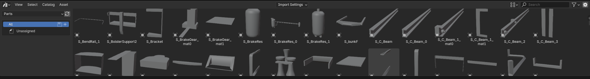

Select different asset libraries from the menu on the left.
****

<<<

==== Add-Ons

(((Blender, "Add-ons")))

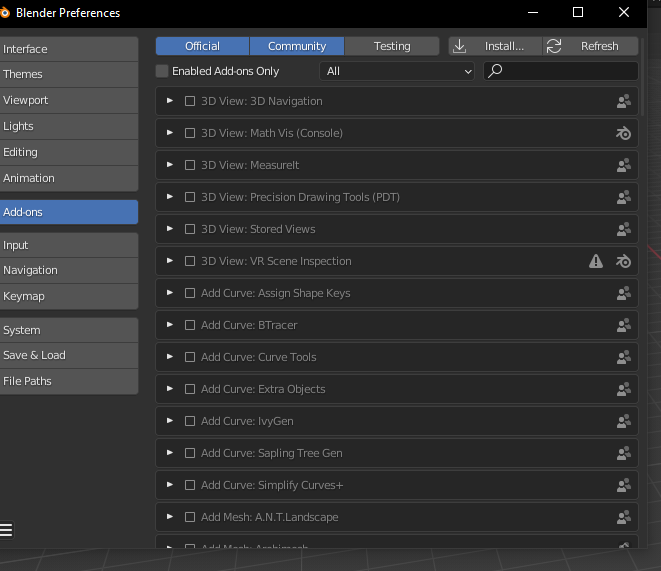

The Add-ons section manages scripts that extend Blender. Add-ons can add importers, exporters, panels, tools, and automation features. You can search, install, enable, disable, and configure them here.

Official:: Add-ons written by Blender developers or distributed through Blender's official channels.
Community:: Add-ons written by Blender community members.

[NOTE]
Blender 4.x includes an Add-on Manager and Extensions system for installing add-ons from the internet. Enable `Allow Online Access` in System preferences if you want Blender to download add-ons directly.

[TIP]
In current Blender versions, click the `Install` button beside an add-on to download and install it. You can search by name or category using the search bar.

===== Installing Add-Ons with Version 4.x

Blender add-ons expand Blender with tools, import/export features, UI panels, and automation. Add-ons may be bundled with Blender, downloaded by Blender, or installed from third-party ZIP packages.

===== Enabling Built-In Add-ons

. Open *Edit → Preferences…*
. Select the *Add-ons* tab.
. Search for the add-on.
. Enable it with the checkbox beside its name.

NOTE: Some bundled add-ons may require a small download the first time they are enabled.

===== Installing Third-Party Add-ons

. Download the add-on as a `.zip` file.
. In Blender, open *Edit → Preferences → Add-ons*.
. Click *Install…* in the upper right.
. Select the ZIP file and click *Install Add-on*.
. Enable the add-on with its checkbox.

TIP: Do not extract the ZIP unless the add-on's instructions tell you to. A Blender-installable ZIP normally contains an `__init__.py` file at its root.

==== After Installation

Add-ons may:

* Add panels to the Sidebar, opened with kbd:[N].
* Add menu items under *File → Import* or *File → Export*.
* Add settings in the add-on's Preferences section.

If *Auto Save Preferences* is enabled, Blender remembers enabled add-ons the next time it starts.

=== Add-on File Locations

|===
|Type |Location

|Built-in Add-ons
|Installed with Blender in the program directory

|User-installed Add-ons
|Stored in the user profile without requiring administrator access
|===

To reveal an installed add-on's location, use:

*Preferences → Add-ons →* Gear icon → *Show in File Browser*

=== Troubleshooting

|===
|Issue |Solution

|Add-on does not appear after installation
|Make sure you selected a ZIP that contains an `__init__.py` at the expected level, not a ZIP that contains another folder inside it.

|Add-on throws errors
|Check that it supports your Blender version.

|Panel or tool is not visible
|Check the Sidebar with kbd:[N] or look under *File → Import/Export*.

|Add-on is disabled after restart
|Enable *Auto Save Preferences*.
|===

TIP: Download add-ons only from trusted sources such as GitHub, Blender Market, or other reputable sites.

==== Also in Blender 4.x - Extensions

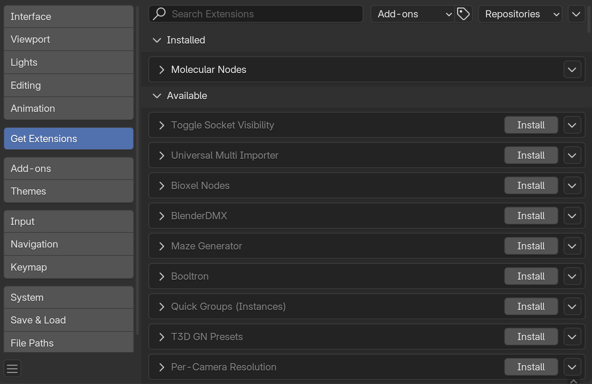

Blender 4.x introduced the Extensions system. Extensions include add-ons, themes, keymaps, and other modular packages. They are managed through Blender's extension tools and the official Blender Extensions Platform at extensions.blender.org.

Extensions are meant to make finding, installing, enabling, updating, and removing modular features easier from inside Blender.

[NOTE]
The term "Add-ons" is still valid. Newer Blender versions use "Extensions" to cover more than Python add-ons.

To enable the feature the first time:

* Open *Edit → Preferences* and go to the *Extensions* or *Get Extensions* tab.
* If prompted, allow Online Access.
* Blender will show available extensions from the official platform.

To browse for extensions:

* Click *Get More Extensions* at the bottom of the Extensions tab.
* Blender opens the Extensions Platform website in your browser.
* Search by name, category, or author.

To install, enable, update, or uninstall extensions:

* Click *Install* beside the extension you want.
* Use the checkbox to enable or disable it.
* Click *Update* when an update is available.
* Click *Uninstall* to remove it.

==== Enabling and Disabling Add-Ons

[NOTE]
Blender no longer bundles every built-in add-on directly in the installer. Some must now be downloaded from the internet.

Enable or disable an add-on by checking or unchecking its checkbox. Enabled add-ons are available immediately.

Use the search option to find a built-in add-on, then enable it with the checkbox.

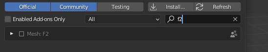

Add-ons are grouped by type, such as Mesh, Import-Export, Curve, and so on.

Recommended built-in add-ons to start with:

* MESH: `LoopTools`
* MESH: `F2`
* MESH: `Edit Mesh Tools`
* NODE: `Node Wrangler`
* ADD CURVE: `Extra Objects`
* ADD MESH: `Extra Objects`
* MESH: `Automirror`

[TIP]
When searching, use the add-on name on the right. For example, type `F2` to find the F2 add-on.

Loop Tools:: An Edit Mode add-on with operators for circles, curves, bridges, segments, flattening, twisting, lofting, and spacing vertices. It appears in the kbd:[N] panel under the `Edit` tab and in the kbd:[RMB] menu.
F2:: A face-creation add-on that speeds up filling holes and repetitive face creation. It uses the kbd:[F] key.
Edit Mesh Tools:: An Edit Mode add-on with tools for vertices, faces, and edges. It appears in the kbd:[N] panel and kbd:[RMB] menu. It is worth experimenting with, especially for face operations.
Node Wrangler:: A node-editing add-on. Useful shortcuts include kbd:[Ctrl+Space] for the general menu, kbd:[Ctrl+T] for texture and UV nodes, kbd:[Ctrl+Shift+T] for PBR texture setup, kbd:[Ctrl+Shift+LMB] to isolate a texture, kbd:[Alt+RMB] for mixed shader nodes, and kbd:[Ctrl+RMB] for quick links.
ADD CURVE: `Extra Objects`:: Adds curve primitives such as arcs, arrows, cogwheels, cycloids, flowers, helices, noise shapes, profiles, rectangles, splats, stars, knots, and other variants.
ADD MESH: `Extra Objects`:: Adds mesh primitives such as beams, gears, honeycomb, diamonds, pipe joints, stars, wall builders, and other shapes.
Automirror:: A quick mirroring tool with several options. It is simpler than using a Mirror modifier in some situations.

===== 3rd Party Add-Ons

The following third-party add-ons are useful for this workflow. One is optional if you also model for Dovetail Games Train Simulator.

(((Blender, "Community Add-ons")))

1) Blender28toMSTS

* Available from: https://github.com/pwillard/Blender_MSTS_ORTS_Exporter/blob/main/Blender_MSTS_ORTS_Exporter.zip
* Video: footnote:[Youtube https://youtu.be/j3AVw7s9qoA]
* Older instructions said to unzip the file before using Blender's install option because support files in the distributed ZIP prevented direct installation.
* Docs: https://github.com/pwillard/Ebook-MSTSORTSExporter/blob/main/MSTSORTSExporter.pdf

2) Edge to Curve

* Available from: https://github.com/Stromberg90/Scripts
* Converts mesh edges into curve shapes that can later be converted back to mesh. Useful for handrails and pipes.

3) Export To Blend

* Available from: https://blendermarket.com/products/export-to-blend
* Price: $5.00
* Exports selected objects to a new `.blend` file while preserving materials, textures, and texture coordinates. Useful for creating a library of reusable model parts.

4) TrainSimTools

* Available from: https://github.com/pwillard/TrainSimTools/releases/tag/v1.0.0
* Optional add-on for MSTS/ORTS model setup and manipulation.
* It can create required collection structures automatically so you do not need to hard-code them into your startup file.
* This is useful when you work on both train-simulator and non-train-simulator models.
* This add-on is a work in progress.

[NOTE]
====
Most recommended add-ons are free, but some useful add-ons are paid.

Many add-ons are developed outside the Blender project. BlenderMarket, now called Superhive (https://superhivemarket.com/), and Gumroad are common places to find them.

To install third-party add-ons, choose btn:[Install…] and select the `.zip` or `.py` file. After installation, enable or disable the add-on with its checkbox.
====

[TIP]
====
*BLENDERKIT*

_From Marek at Elvas Tower:_ I have been using the free `BlenderKit` add-on. It is enabled from *Preferences > Add-ons*. `BlenderKit` includes thousands of materials. Rubber, metal, plastic, and checker-plate materials are useful for rolling stock.

Because procedural materials can be scaled without losing image quality, they can help create details such as walkways. I rendered the walkway from the same top-down camera used for the {AO}, edited the render in GIMP, and placed it on the texture file. Because the orthographic camera scale did not change, it aligned with the {AO} layer. This gave much better results than previous methods.

Blender's render engine and 3D texture-painting tools are worth exploring as additional tools for texture artists.
====

==== Exit and Save Preferences

Closing menu:Edit[Preferences] saves changes automatically unless you disabled `Auto Save Preferences` in the hamburger menu at the bottom of the Preferences window.

<<<

=== Other Settings

Next, adjust useful header and properties-panel settings. These settings are optional, but they are worth reviewing.

==== TABS

(((Blender, "TABS")))

The top of the Blender window contains workspace tabs. You do not need every tab for {OR} modeling. The *Modeling* tab is similar to the *Layout* tab and is mostly a holdover from older Blender versions, so you can delete it if you want more room. The Sculpting tab is also rarely needed for hard-surface modeling.

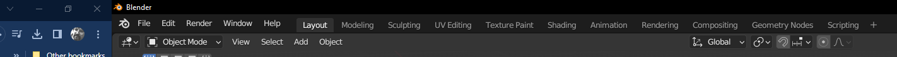

[NOTE]
Tabs can be restored with the `+` button. Save workspace changes with menu:File[Defaults > Save Startup File].

<<<

==== Scene Settings

(((Blender, "General Settings")))

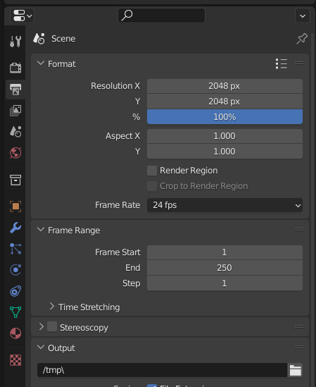

Set the default output resolution to 2048 x 2048 because square textures are common. {OR} does not require square textures the way {MSTS} does, but square textures are still useful for consistency.

==== Gizmo settings

[TIP]
This is optional and depends on personal preference. Some users find the extra controls cluttered.

In the Layout window, open the Gizmos drop-down menu. It uses an arc-and-arrow icon. Enable the Move option if you want axis-based move arrows for moving objects. You can also move objects with the kbd:[G] key.

==== Overlays

The Overlays icon is next to the Gizmo options.

Enable `Statistics` in Overlays so you can watch polygon count while modeling.

[TIP]
This is also optional and can make complex scenes look cluttered.

To show edge lengths, select the default cube, switch to Edit Mode with kbd:[Tab], open the Overlays drop-down, and enable `Edge Length`. If there is no cube, add one with menu:Add[Mesh > Cube]. This displays selected edge lengths in Blender units. Add-ons such as Construction Lines can provide more advanced measurement tools.

<<<

==== Shading Settings

(((Blender, "Shading Settings")))

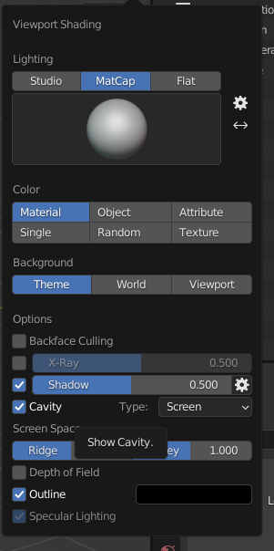

Under Solid Viewport Shading, open the drop-down beside the solid-circle icon and enable:

* Shadow
* Cavity

These settings make shapes easier to see while editing.

(((Blender, "MATCAP")))

[TIP]
MATCAP shading can make shapes easier to read during early modeling. The leftmost MATCAP option is often useful for seeing form and surface errors.

<<<

==== Units

(((Blender, "Units of Measure")))

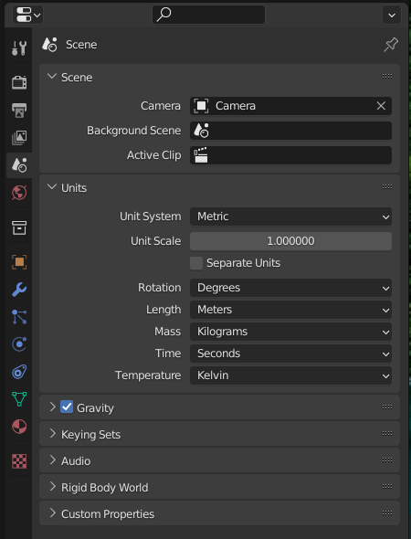

(((Blender, "Units, Feet, Meters, Metric, U.S. customary units ")))

If you need U.S. customary units instead of metric, change the Unit System in Scene Properties.

[IMPORTANT]
Changing units can affect Camera View settings such as `Focal Length`, `Clip Start`, and `Clip End`. If part of your model disappears when you zoom out, adjust the clip settings in the _N-Panel_ `View` tab.

<<<

==== Scene (Rendering)

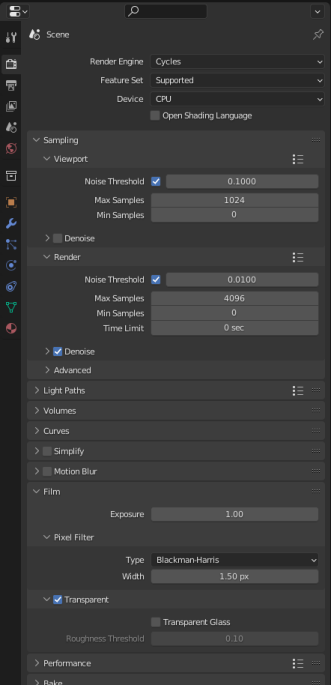

These render settings are optional, but they improve output quality.

In menu:Properties Panels[Scene > Render Engine > Eevee], set Sampling > Render to 200 samples.

In menu:Properties Panels[Scene > Render Engine > Cycles], set Sampling > Render to 200 samples.

In menu:Properties Panels[Scene > Film], enable `Transparent`. This removes the render background, which is usually useful for model renders.

(((Blender, "Blender, SHADING")))

==== Shading

The Shading tab can use HDRI images for general scene lighting instead of relying on light objects.

First, download an HDRI file. Store HDRI files in a folder such as menu:Documents[Blender > HDRI].

In the World Properties panel, shown with a globe icon, set the Surface to `Background`. In the Color section, choose `Environment Texture`, then click `Open` and select the HDRI file.

After this, rendered images use the HDRI for lighting.

To see the HDRI in the viewport, open the `Shading` tab, choose the Viewport Shading icon to the right of Solid Shading, open the viewport shading drop-down, and set lighting to `Scene World`.

If you did not enable `Transparent` in Film settings, the HDRI would also become the render background.

[TIP]
The `Abandoned Slipway` HDRI from https://hdrihaven.com has been recommended by Josh Gambrell for neutral outdoor lighting. The `hdri_004_nordicfxnet.hdr`, also called "Railroad Crossing," from http://www.nordicfx.net/ may fit rail projects better. I reduced it from 4K to 2K.

[TIP]
The free "EASY HDRI" add-on can make HDRI world-lighting setup easier. It is optional.

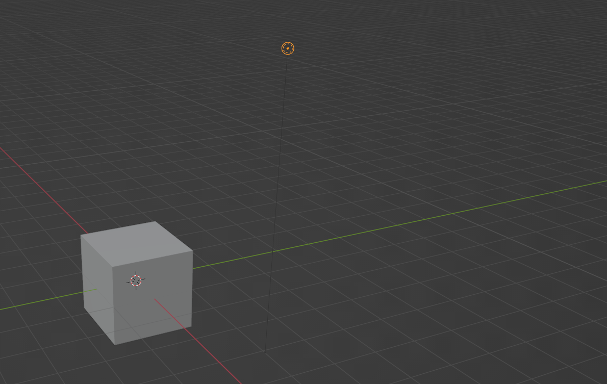

After replacing the default lighting workflow with HDRI lighting, delete the default light object from the Scene Collection or main 3D view.

<<<

=== Done, for now... almost

One last setup step:

Press kbd:[N] to open the Number Panel, also called the _N-Panel_. It lets you adjust object settings and locations by entering numbers. Leaving it open in the startup file makes it available for new Blender projects.

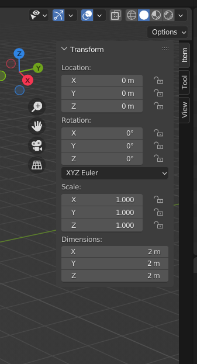

Save the setup with:

menu:File[Defaults > Save Startup File > Confirm]

Your basic preferences and startup-file options are now ready for 3D modeling simulator assets.

<<<
(((Project, "Folders")))

== Folder structure

Project-folder layout is personal. The following example shows one organization method.

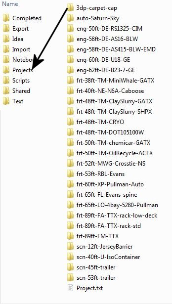

(((Project, "Folder Layout")))

[NOTE]
Many details are omitted for brevity. Useful folders include `EXPORT` for renders and exports, `IMPORT` for items converted from 3D Canvas, Train Sim Modeler, or other sources, and `PROJECTS` for active work. A `SHARED` folder can hold common asset libraries and textures. Prefixes can also help organize content, such as `FRT` for freight cars, `SCN` for scenery, and `ENG` for engines.

<<<

== Content Creation Overview

The next sections are not just about Blender modeling. They describe how to create items that meet simulator requirements and conventions. Some older 3D Crafter notes are included where useful.

(((Content Creation, "Basic Overview")))

[TIP]
This document began as a notebook of content-creation notes. Some topics may feel like gathered notes rather than a finished textbook. Expect updates and revisions over time.

=== Orientation
((( Content Creation, "Orientation")))

Rolling stock and engines must be oriented correctly. In some older 3D programs, such as 3D Crafter / 3D Canvas or Maya, Z may represent depth, X width, and Y height. Blender is closer to 3ds Max: Z is height, X is width, and Y is depth.

For track vehicles, the front of the model points toward positive Y. The rear points toward negative Y.

[WARNING]
Blender's default front view is different. Blender considers the front to face the -Y direction. Pressing kbd:[1] on the keypad shows Blender's front view, which is the back end from the {MSTS}/{OR} perspective.

=== Engine/Wagon Model Hierarchy

(((Content Creation, "Engine/Wagon Model Hierarchy")))

The Blender exporter requires a collection named `MAIN`. This is the root of the model hierarchy. The model itself is not placed directly in `MAIN`; instead, model parts are placed in child LOD collections such as `MAIN_700` and `MAIN_2000`.

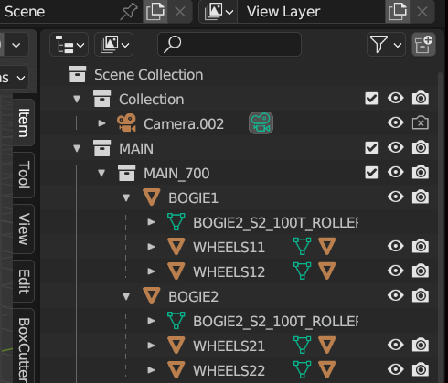

[WARNING]
The Blender exporter expects required collection names to be capitalized, such as `MAIN`, `MAIN_700`, `BOGIE`, and `WHEEL`. Names such as `main` or `main_700` will cause export errors.

For {OR} to animate wheels and bogies correctly, the model hierarchy, names, parenting, and pivot origins must be correct. In the following example, the A-end of the boxcar is on the right, the B-end with brakes is on the left, and default travel is from left to right. See the Orientation section above.

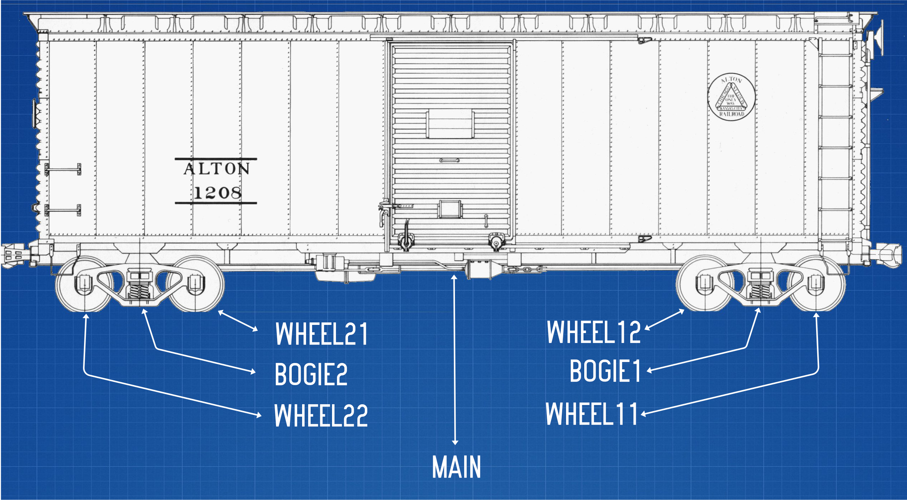

[TIP]
For a two-bogie, two-axle arrangement, each wheel object should use the center of its axle as its pivot. Each bogie should use its own center of mass as its pivot. Most other parts use world origin as their pivot.

[NOTE]
The main body mesh does not need to be named `MAIN`. Modelers have used that name by convention since 2002, but the exporter only requires the `MAIN` collection to exist.

[WARNING]
Be careful when selecting all objects and applying all transformations. This can reset all object origins to world origin, which would break bogie and wheel pivot points.

=== Standard 2 Axle Freight Bogies
(((Content Creation, "Standard 2 Axle Freight Bogies")))

From the left-side view, the model faces right. Starting from the right side, name bogies and wheels according to the hierarchy diagram. The correct wheels must be parented to `BOGIE1` or `BOGIE2`.

For an extra axle, use `WHEELS13` or `WHEELS23` behind the bogie pivot relative to forward motion, and shift wheel set 2 to the center of that bogie. Keep the naming sequence from 11 through 23 as shown. Incorrect order can cause wheels to rotate backward or shift incorrectly in {MSTS}.

[NOTE]
A two-axle bogie would not use `WHEELS13` or `WHEELS23`.

=== Isolated Axles

The {MSTS} naming standard for isolated, non-bogie axles is `WHEEL1`, `WHEEL2`, `WHEEL3`, and so on.

NOTE: These are mainly used for steam locomotives. Their animation is not automatic and must be created in Blender. Steam wheel and linkage animation uses 16 frames and should be treated as an advanced topic.

In {OR}, the important parts appear to be the `WHEEL` and `BOGIE` prefixes. `WHEEL` is required for wheel animation and proper bogie parenting. `BOGIE` is required for bogie animation and proper engine or wagon parenting.

[WARNING]
Some {MSTS} documentation implies that a third bogie is possible in {MSTS}. It is not. If you are modeling specifically for {OR}, the simulator can animate correctly named bogie and wheel objects as long as parenting and local pivot origins are correct.

Microsoft recommended this topology for the Acela model:

----
MAIN ENGINE
PANTOGRAPHTOP1
        PANTOGRAPHBOTTOM1
    PANTOGRAPHTOP2
        PANTOGRAPHBOTTOM2
    BOGIE1
        WHEELS11
        WHEELS12
    BOGIE2
        WHEELS21
        WHEELS22
    MIRRORRIGHT1
    MIRRORLEFT1
    WIPERARMLEFT1
        WIPERBLADELEFT1
    WIPERARMRIGHT1
        WIPERBLADERIGHT1
----

=== OpenRails Animation

The following names and prefixes identify engine or wagon objects that can be controlled by simulator animations. You may add text after the listed prefix to create multiple matrices using the same trigger. For example, `MIRROR` and `MIRROR_LEFT_1` can both be controlled by the mirror animation.

*Animated object list:*

[cols="2,3", options="header"]
|===
| Item / Pattern | Description

| WIPER
| Wiper animation

| DOOR_A / DOOR_B / DOOR_C
| Right door animation

| DOOR_D / DOOR_E / DOOR_F
| Left door animation

| PANTOGRAPHBOTTOM1 / PANTOGRAPHMIDDLE1 / PANTOGRAPHTOP1 / PANTO with 1 elsewhere in the name
| First pantograph animation

| PANTOGRAPHBOTTOM2 / PANTOGRAPHMIDDLE2 / PANTOGRAPHTOP2 / PANTO with 2 elsewhere in the name
| Second pantograph animation

| PANTO with 3 elsewhere in the name
| Third pantograph animation

| PANTO with 4 elsewhere in the name
| Fourth pantograph animation. Open Rails currently hardcodes support for four pantographs.

| MIRROR
| Mirror animation

| LEFTWINDOWFRONT
| Front left window animation

| RIGHTWINDOWFRONT
| Front right window animation

| LEFTWINDOWREAR
| Rear left window animation

| RIGHTWINDOWREAR
| Rear right window animation

| UNLOADINGPARTS
| Rotary unload animation

| ORTSBELL
| Bell animation

| ORTSITEM1CONTINUOUS
| Generic control 1 looping animation

| ORTSITEM1TWOSTATE
| Generic control 1 toggle animation

| ORTSITEM2CONTINUOUS
| Generic control 2 looping animation

| ORTSITEM2TWOSTATE
| Generic control 2 toggle animation. Open Rails currently hardcodes support for two generic controls.

| ORTSBRAKECYLINDER
| Brake cylinder animation

| ORTSHANDBRAKE
| Handbrake animation

| ORTSBRAKERIGGING
| Brake rigging animation
|===

[NOTE]
Any animation attached to a wheel without a special name is assumed to be running-gear animation.

[TIP]
Any engine or wagon can include these animation names, but not every animation makes sense for every vehicle. For example, wipers are not useful on a freight car.

=== Configuration Files Overview

(((Content, "Configuration Files")))

The Open Rails manual explains many features that are available only in Open Rails. The current manual is limited on content-creation details, but much of the old Microsoft Train Simulator content-creation information still applies.
(((Configuration, "Files")))

This notebook is not a complete guide to `sd`, `ref`, `eng`, and `wag` files, but you will need working configuration files to add content to {OR}. Peter Newell's website has detailed information about good `ENG` and `WAG` files for {OR}. footnote:[https://www.coalstonewcastle.com.au/physics/format/]

Scenery objects normally require an `sd` file when built for {MSTS}. {OR} can use a different scenery definition method, which makes the SD file unnecessary in many cases.

Also see <<creating-rolling-stock-and-locomotives,Creating Rolling Stock and Locomotives>>.

=== Include Files in Configurations
(((Configuration, "Include")))

`Include()` statements are becoming more common in {OR} SIMIS files, but includes are optional.

In both {MSTS} and {OR}, `.wag` and `.eng` files identify an asset as a locomotive or non-powered vehicle. Historically, these files were large, complicated, and full of repeated data. MSTS files usually had to be self-contained. In {OR}, `.wag` and `.eng` files can include shared `.inc` files, which makes the main files smaller and easier to maintain.

Include files are especially useful when creating several similar cars that differ only in details such as reporting marks.

An `.inc` file does not have to be in the same directory as the `.wag` or `.eng` file, although that is sometimes easiest. It only needs to be referenced in a way {OR} can find.

[WARNING]
When `.inc` files are used by `.eng` or `.wag` files, they need a blank line at the beginning. For safety, also leave a blank line at the end.

When ORTS loads a locomotive or car, it reads the main `.eng` or `.wag` file until it reaches an `Include` statement. It then locates and reads the `.inc` file, inserts that data into the physics data, and returns to the main file. It repeats this process for additional include statements.

*Common include-file locations:*

* A subfolder inside the `.wag` or `.eng` folder.
* Directly in the `.wag` or `.eng` folder. This can become messy, so use caution.
* A special folder for files shared by `.wag` or `.eng` files that use the same `.s` shape.
* A common folder shared by many `.wag` or `.eng` files.

Create a naming standard that supports both common shared files and files specific to a master shape.

==== General INC file structure

(((Configuration, "Include, Structure")))

INC files are still standard {OR} configuration documents, so SIMIS rules still apply. Keep these points in mind:

* The first line of the INC file must be blank.
* Do not include a SIMIS header line such as `SIMISA@@@@@@@@@@JINX0D0t______`.
* Use `COMMENT()` sections generously.
* INC files are most useful for shared configuration values.
* INC files are for {OR} only. MSTS cannot use them.
* {OR} reads include files from top to bottom. If values are duplicated, the last value read overrides earlier ones.

==== Items well suited to INC files

* Coupler details shared by many locomotives or cars.
* Wagon details shared by many locomotives or cars, such as sound references and empty/loaded states.
* Brake details shared by many locomotives or cars.
* Lights shared by similar vehicles.
* Davis coefficients shared by similar vehicles.

Use includes thoughtfully. They can simplify a project, but they can also become complicated quickly.

==== Specifying relative references

(((Configuration, "relative reference")))

{OR} must be able to locate your INC files. Use references that are relative to the main file whenever possible.

* If the INC file is in the same folder, use `INCLUDE("filename.inc")`.
* If it is in a subfolder, use `INCLUDE("subfolder/filename.inc")`.
* If it is elsewhere, use an absolute path such as `INCLUDE("C:/path/to/filename.inc")`, or a relative path such as `..\common.inc\filename.inc` to refer to a common folder one level up.

[NOTE]
There is a way to keep content compatible with legacy MSTS while using this technique, but it is not covered here.

_An interesting discussion occurred in 2017 about making these files better and more useful in the post-Microsoft Train Simulator world._

[quote, Erick Cantu, 20 November 2017]
_____
KUJU defined many of the folder names used in {MSTS}. The Include file concept for `.eng` and `.wag` files led me to think that something like KUJU's `\common.cab` directory tree was needed for `.inc` files.

Payware vendors used several folder approaches under `\trains`: sometimes `\common.cab`, sometimes a product-specific folder, and sometimes a vendor folder for an unskinned mesh, such as `3DTrains_FPack`.

The KUJU CAB file provides a useful example for locating include files. After experimentation, I propose a solution that addresses these needs:

* A shared folder for `.inc` files, much like `\common.cab`.
* Recognition that users may have routes and equipment from many countries, so grouping certain files by country may be useful.
* Acceptance that payware vendors may sell the same mesh in many railroad skins while distributing each railroad in a unique folder.
* A simple approach for cases with minimal commonality, where everything belongs in one folder.
_____

<<<

=== Config File Deconstruction

(((Configuration, "Deconstruction")))

A configuration file has two basic parts:

* Header: the first line, identifying the file type and version.
* Body: the actual configuration data.

==== Header

The first line is always the header. It begins with `SIMISA@@@@@@@@@@JINX0D0t______` and is followed by a blank line. It identifies the file type and version; it is not part of the vehicle data. Different file types can use different header lines.

[source,text]
----
SIMISA@@@@@@@@@@JINX0D0t______

----

==== Body

The body contains the configuration data.

Below is a basic MSTS-compatible wagon configuration example:

[source,text]
----
Wagon ( CP_218041_LD
    Type ( Freight )
    WagonShape ( CP_218041.s )
    Name ( "HiCube 60 CP 218041 LD" )
    Size ( 3.108m 5.211m 20.531m )
    comment ( 38.46t empty, ~115t full )
    Mass ( 120t-us )
    WheelRadius ( 36in/2 )
    InertiaTensor (
        Box ( 3.1m 3.54m 19.931m )
    )
    Comment("===================== Coupling =====================")
    Coupling (
        Type ( Automatic )
        Spring (
            Stiffness ( 8e4N/m 4.5e6N/m )
            Damping ( 2e6N/m/s 2e6N/m/s )
            Break ( 250000lb 250000lb)
            r0 ( 12cm 12cm )
        )
        Velocity ( 0.2m/s )
    )
    Coupling (
        Type ( Automatic )
        Spring (
            Stiffness ( 8e4N/m 4.5e6N/m )
            Damping ( 2e6N/m/s 2e6N/m/s )
            Break ( 250000lb 250000lb)
            r0 ( 12cm 12cm )
        )
        Velocity ( -0.2m/s )
    )
    Commant("===================== Derail, Davis and Braking =====================")
    DerailRailHeight ( 5cm )
    DerailRailForce ( 2.5*115t )
    DerailBufferForce ( 1123kN )
    NumWheels ( 8 )
    ORTSBearingType ( Roller )
    ORTSDavis_A ( 1168.33 )
    ORTSDavis_B ( 18.9210 )
    ORTSDavis_C ( 1.928619 )
    Commant("===================== Brakes =====================")
    BrakeEquipmentType ( "Handbrake, Triple_valve, Auxilary_reservoir, Emergency_brake_reservoir" )
    BrakeSystemType ( "Air_single_pipe" )
    comment ( Load/Empty valve? = Yes )
    MaxBrakeForce ( 67.665kN )
    MaxHandbrakeForce ( 112.776kN )
    NumberOfHandbrakeLeverSteps ( 100 )
    BrakePipeVolume ( 0.61ft^3 )
    EmergencyResCapacity ( 0.973ft^3 )
    ORTSBrakeShoeFriction ( 0.0 0.49 8.0 0.436 16.1 0.4 24.1 0.371 32.2 0.35 40.2 0.336 48.3 0.325 56.3 0.318 64.4 0.309 72.2 0.304 80.5 0.298 88.5 0.295 96.6 0.289 104.6 0.288)
    EmergencyBrakeResMaxPressure ( 90 )
    TripleValveRatio ( 2.5 )
    MaxReleaseRate ( 50 )
    MaxApplicationRate ( 50 )
    MaxAuxilaryChargingRate ( 20 )
    EmergencyResVolumeMultiplier ( 1.461 )
    EmergencyResChargingRate ( 20 )
    BrakeCylinderPressureForMaxBrakeBrakeForce ( 77 )

    Commant("===================== Sound =====================")
    Sound ( "..\\..\\TS_COMMON_SOUND\\freight.sms" )

)
----

This file contains the main wagon definition, coupling definitions, derail and braking values, Davis coefficients, and the sound reference. The wagon definition gives the type, shape, name, size, and mass. The coupling sections define coupling type, stiffness, damping, break force, and velocity. The braking section defines brake equipment, brake system, brake force, and related physics values.

The shape file and sound file are external references, and the example uses legacy MSTS-compatible paths.

[TIP]
The coupler and braking sections are good candidates for INC files if they are shared by several models. This keeps the main WAG file smaller and easier to maintain.

=== Example ORTS Configuration Layout

(((Configuration, "Sample Layout")))

`Include()` statements can be added to SIMIS files, but they are most useful in `.wag` and `.eng` files.

The following example outlines a standard boxcar WAG layout. Because my work focuses on RailSimStuff.com, I use the RSS prefix.

* NAVS Freight Sounds: `NAVSFR10.ZIP`
* Coupler details: `RSS_COMMON.INC`
* Wagon details: `RSS_WAGON.INC`
* The main WAG file contains the freight animation decal definitions.

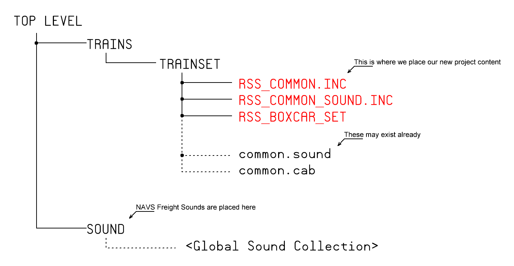

[NOTE]
If you use Visual Studio Code, use `File: Open Folder` to open the folder containing the `.wag` and `.eng` files. This makes it easier to navigate to related `.inc` files. A VS Code add-on for ENG/WAG syntax highlighting is available at https://github.com/matejpacha/ORTSFileSupportForVSC

=== 3rd Party Configuration Tools

(((Configuration, "3rd Party Tools")))

There are several tools that can help with configuration file creation or editing. They are not required, but they can make the process easier.

In addition to the VSCODE highlighter tool mentioned above, the following tools could be useful:

|===
|Name   | Location   | Description

|WAG Include Editor  | https://github.com/pwillard/WagInclude/releases | A Windows tool for editing WAG files and their INC files. It can edit existing WAG files, and manage INC files. It is a work in progress.  
|Shape File Manager 3 | https://github.com/pwillard/SFM3/releases | A Windows tool for managing shape files and their associated textures. It can minimally edit existing ones, it can compress and uncompress files. It is a work in progress. It is a modern update of the original Shape File Manager (SFM) tool by Paul Gausden.
|MSTS Engine File Computations | https://trainsim.com/forums/filelib/search-fileid?fid=66546 | A Windows tool for computing engine file values.
|MSTS ENGMOD |https://trainsim.com/forums/filelib/search-fileid?fid=60461 | A Windows tool for editing engine and wagon files. 

|===

=== General Modelling Standards from Erick Cantu
(((General Modeling Standards, continued)))

These notes from Erick Cantu are important enough to preserve as a reference. They were extracted from Elvas Tower forum posts and are useful if you want to model with similar standards. They are guidelines, not hard rules.

[WARNING]
Erick gives detailed modeling guidance here. Read and keep these points in mind when planning your own models.

==== Erick Says

* Match the right trucks to the right car. This includes wheel size and truck wheelbase, not just broad truck type. Erick built a library of freight-car trucks for this reason. His truck library is available at Elvas Tower, and importing those trucks into Blender could be very useful.
* Map standard-definition cars at about 1/2 inch per pixel. Align adjoining car surfaces within 1/1000 of a pixel so continuous lines do not break. Map car sides separately. Many cars can use the top or bottom half of a 2048 x 2048 sheet, which creates large continuous surfaces and lets one sheet support two paint schemes.
* A useful setup is four shape files: two mapped to the top and bottom of the first texture sheet, and two mapped to the top and bottom of the second. This supports four paint or weathering patterns per car folder, while numbers can be applied with decals so one shape can represent many cars.
* Texture mapping should be intuitive and paintable. Ask: Would I want to paint this? Could I repaint it for another railroad? Can unneeded parts be hidden with alpha? Could I paint it without constantly checking in Shape Viewer? Avoid awkward angled mappings that make straight lines difficult.
* Use consistent bitmap resolution and mesh resolution across a car and across related parts. Ideally, the top LOD should stay near 12,000 triangles or less, with careful vertex optimization, limited hard edges, and welded UV coordinates where possible.
* Aim for one texture sheet for the car body and one for the trucks. If alpha is needed, the whole car body can often use one BlendATexDiff material with the -Trans flag off. Add extra materials only for a clear reason, because each material adds a draw call. Trucks can use a separate texture because animated parts already create a separate draw call.
* Texture resolution and mesh resolution should match the intended viewing distance. Do not build highly detailed parts with high-resolution textures on a low-resolution model. Detail that greatly exceeds the rest of the model wastes texture space and vertices. There are exceptions, such as number boards with alpha edges, where higher texture resolution may be needed for acceptable results.
* Avoid splitting car sides into multiple sections unless necessary. It adds mesh divisions and UV coordinates. Very long cars may require it, but cars around 60 feet or less usually do not if planned well. Multiple car bodies can share one texture sheet, and this can reduce total train texture counts.
* Place the top node's pivot about 2 inches below the rail so the wheels sit correctly. You may still need to adjust ride height.
* Consistent detail helps cars look good together. Air hose heights should match across cars. Erick uses brake hose ends at 14.5 inches above the rail and extends them to meet the next car's hose, held as in the real world with a chain or cable.
* Couplers passing through other couplers look bad. It is often best to make couplers part of the truck mesh or link them to the trucks. Exceptions include cars where truck centers and couplers are far apart, such as auto-racks or cushioned boxcars.
* Keep draw-call counts low and texture counts even lower. A car body should use one texture sheet and one material unless another material is truly needed. Multiple car bodies can share a single square sheet if needed.
* Avoid unnecessary 1-bit alpha and aliased edges. OR handles 32-bit textures correctly, so separate materials for 1-bit and 8-bit alpha often just add draw calls. Use one material with 8-bit alpha where possible. A 1-bit alpha channel is acceptable only for perfectly square transparent areas.
* Do not leave freight-car undersides empty. The old {MSTS} habit of leaving the underside open can show sky through the car when viewed from below, especially on bridges. The underside does not need to be complex, but it should exist.
* Use the units that match your references. Aircraft references may be in decimal inches or meters. U.S. rolling stock references are often in inches. A scale calculator makes conversion manageable, and you may grow to like metric.
* Do not add imagined details. Model as accurately as practical.
* Within your target viewing distance, model visible details at a resolution consistent with the rest of the model. Brake rigging can be complete but simple if the car is normally viewed from far enough away that the whole car is visible.
* Taper wheel treads. It is obvious when they are not tapered.
* Weld UV coordinates wherever possible. Texture vertices matter as much as draw calls.
* Plan hard edges deliberately. If an edge is always in a dark area, smoothing it may be better.
* Cars should look good from all likely viewing angles, including below.
* Blender can export a UV image. Import this image into your paint program as a reference layer so you can see where texture shapes are located.
* Smaller round parts need fewer sides. Wheels may use 24 sides at the rims, but 12 or 10 sides inside the dish. Edges matter, but they can hide a lot.
* Coupler heights may vary. Air hose heights should not. Consistent hose height prevents mismatches between cars.
* If a feature cannot be done well, leave it out. For example, track sounds for switches and crossings can break immersion if they cannot account for truck spacing or wheel count.

The main point is to make deliberate choices. Small inefficiencies add up across a long train, especially with AI traffic. Erick's move from individual car textures to shared paint and weathering variations with decal numbers reduced texture counts dramatically. For example, 100 BN hoppers can use 13 texture sheets with decals, instead of about 51 sheets without them.

=== Additional guidance from Blender Brothers

From Pete Willard:: Josh from Blender Brothers was one of my mentors when I was learning Blender. I subscribed to their YouTube channel and still receive updates about their ideas and tips.

Josh and Ryuu of Blender Brothers say:

"What's the secret to nailing the detailing stage?":: It comes down to understanding where to add detail, how much to add, and what kind of detail fits. That sounds simple, but it takes practice.

==== Blender Brother's Gold Rule

Think in terms of visual anchors. Visual anchors are like stars in a constellation. Your eye moves from one anchor to another, while the space between them becomes negative space. These tips help apply that idea:

* *Embrace the 70/30 Rule* Keep about 70% of the design clean and cluster details in the remaining 30%. This creates visual anchors.
* *Keep Details to scale* Oversized details can make a model look cartoonish. Use reference scale when needed.
* *Do your homework* Use reference images. For example, study real or fictional examples before designing a sci-fi room.
* *Less is more* Do not over-detail one area all at once. Move from area to area and add detail gradually.
* *Create your own library* Build a collection of decals, trim sheets, kitbash parts, and other reusable assets. This speeds up work and keeps your style consistent.

[NOTE]
The Blender Brothers like making their own decals and have recorded a decal workflow using the Decal Machine Blender add-on. Their other videos are also worth watching.

(((Assets, "General Texture Mapping")))

=== General Texture Mapping Guidelines

* Microsoft recommended square texture sizes for {MSTS}, such as 512 x 512, 256 x 256, and 128 x 128. {OR} does not have the same limitation, so a 2048 x 1024 texture can be reasonable.
* Use a paint program that supports layers and can save layered documents. PSD is one layered format.
* PNG files support alpha channels, but they do not preserve layers.
* Consider using PNG files while modeling and DDS files for final {OR} models.
* Consider using modeled decals for reporting marks and car numbers instead of baking them into the main texture. Decals are easier to change and can be reused on multiple models.
* Export and check the model as soon as the UV map exists. It is better to find UV problems early.

==== Some additional tools to consider

* ORZIP:: A free tool that replaces Microsoft Train Simulator's ffeditc_unicode.exe file for compression and decompression of MSTS files. It is available at https://github.com/pwillard/orzip/releases  NOTE: ORSP is a graphical front-end for ORZIP that is also available at https://github.com/pwillard/ORSP/releases
* TextureWorkshop:: A free tool for converting ACE files into multiple other formats. It is available at https://github.com/pwillard/TextureWorkshop/releases
* REPMARK:: Generate transparent PNG decal sheets for railroad reporting marks and numbers. It is available at https://github.com/pwillard/repmark/releases
* Shape Conversion:: A free tool for converting MSTS shape files into Blender-readable formats. It is available at https://github.com/pwillard/ShapeConversion/releases